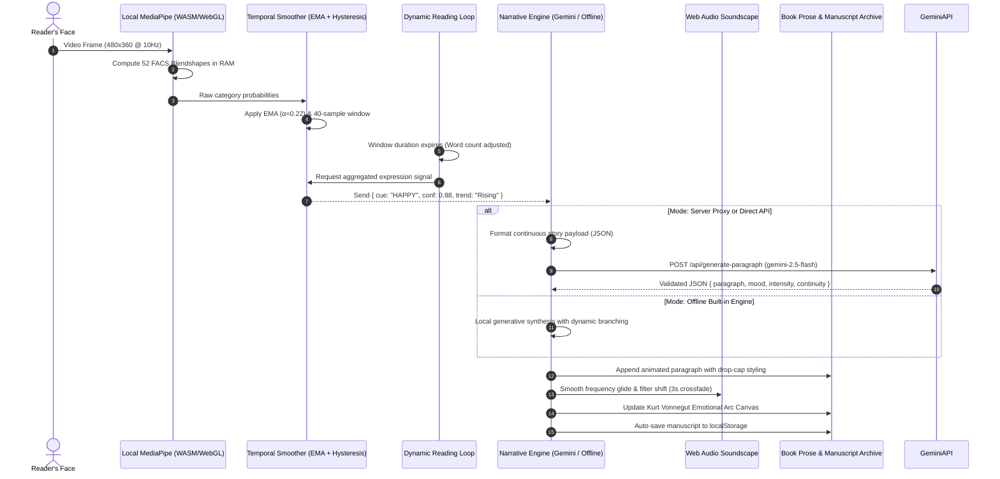

# EMOTIVE — An AI Story That Feels Its Reader

<p align="center">
  
</p>

<p align="center">
  <strong>An adaptive literary engine where Google Gemini generates stories one paragraph at a time, dynamically reshaping narrative atmosphere, plot reversals, pacing, and procedural ambient soundscapes based on local browser facial-expression cues.</strong>
</p>

<p align="center">
  <a href="https://opensource.org/licenses/MIT"></a>
  <a href="https://github.com/iamnih4l/Emotive/actions"></a>
  <a href="https://nodejs.org/"></a>
  <a href="https://developer.mozilla.org/en-US/docs/WebAssembly"></a>
  <a href="https://developer.mozilla.org/en-US/docs/Web/API/Web_Audio_API"></a>
</p>

<p align="center">
  <a href="https://emotive-omega.vercel.app/" target="_blank">
    
  </a>
  &nbsp;&nbsp;
  <a href="https://vercel.com/new/clone?repository-url=https%3A%2F%2Fgithub.com%2Fiamnih4l%2FEmotive&env=GEMINI_API_KEY&envDescription=Google%20AI%20Studio%20Gemini%20API%20Key&envLink=https%3A%2F%2Faistudio.google.com%2Fapp%2Fapikey">
    
  </a>
</p>

---

## 📖 The Prologue: What If the Book Was Reading You?

> *You lean toward your screen at midnight. The salt wind of Eventide lighthouse howls across the cliffside in the prose. You smile softly as Mira discovers her father’s brass astrolabe—and without warning, the ink on the digital page responds.*
>
> *The next paragraph does not offer cheap triumph; it introduces a tender, bittersweet complication. A sealed farewell letter wrapped in worn wool, postmarked for tomorrow. Simultaneously, the ambient synthesizer drone deepens, shifting from open fourths into a poignant minor-seventh chord as rain begins to tap against the glass.*
>
> *The story didn't guess. It felt you.*

Traditional books are frozen artifacts. Conventional AI story generators vomit 1,000 words in a single streaming shot, indifferent to whether the reader is leaning forward in breathless suspense or distracted and smiling.

**EMOTIVE** changes this paradigm:
1. It generates stories **one paragraph at a time** (85–130 words).
2. It pauses across a natural reading observation window (14s–32s).
3. It analyzes subtle facial blendshapes **100% locally on your device** via WebAssembly.
4. It treats your emotional cue as an **artistic counterpoint**—deepening tension, unveiling sudden secrets, or offering solace.
5. It procedurally modulates a **pure Web Audio ambient soundscape** in real time.

---

## 🎭 Interactive Story Demonstrations

Click each tab below to see how the same premise evolves under different reader emotional cues:

<details>
<summary><strong>✨ Case 1: The Reader Smiles (Apparent Happiness) &rarr; Bittersweet Depth</strong></summary>

> **The Philosophy**: In high literature, joy is most poignant when shadowed by fragility. When the reader feels relief, the engine introduces a bittersweet vulnerability or sacrifice.

```markdown
[Paragraph 1 — Opening]:
Mira dusted the sea-salt from the brass astrolabe bolted to the lighthouse parapet, 
certain her father’s log had recorded everything of his final night—until the stone 
mosaic beneath the prism table shifted under her boot heel.

[Reader Cue Detected: HAPPY (Mouth smile + cheek squint | Confidence: 88%)]:
[Narrative Directive: Introduce bittersweet nuance, an unexpected sacrifice, or fragile impermanence.]

[Paragraph 2 — Generated by Gemini]:
That brief warmth of discovery lingered only until Mira lifted the oilcloth beneath the 
mechanism and found his familiar blue wool scarf—still smelling faintly of cedar and rain. 
Wrapped inside it lay an envelope bearing her name, yet the ink postmark bore tomorrow's 
date, and the margin inscription confirmed what she feared most: the protector who had 
safeguarded this sanctuary had done so by surrendering their own name to the sea.
```
</details>

<details>
<summary><strong>⚡ Case 2: The Reader Widens Eyes (Apparent Surprise) &rarr; Hidden Revelation</strong></summary>

> **The Philosophy**: Surprise signals hyper-attunement. The engine rewards close attention by pulling back a layer of the world and reframing earlier clues.

```markdown
[Reader Cue Detected: SURPRISED (Eye wide + brow raise + jaw open | Confidence: 91%)]:
[Narrative Directive: Unveil a concealed structural truth or invert previous assumptions.]

[Paragraph 2 — Generated by Gemini]:
When Mira angled the parchment toward the prism lamp, a second layer of heat-sensitive 
iron-gall ink bloomed across the fibers—inverting everything the ledger had claimed. 
The coordinates did not chart where the vessel had vanished into the squall at all; 
they were an engineer's schematic, proving the tower itself had been constructed to conceal 
a dry subterranean passage running beneath the sea wall into the harbor master's cellar.
```
</details>

<details>
<summary><strong>🔥 Case 3: The Reader Furrows Brow (Apparent Anger) &rarr; Decisive Agency</strong></summary>

> **The Philosophy**: Frustration demands agency. Rather than passive observation, the protagonist takes decisive physical action against an obstruction.

```markdown
[Reader Cue Detected: ANGRY (Brow down + nose sneer + lip press | Confidence: 84%)]:
[Narrative Directive: Ignite confrontation, physical resolve, or breakthrough agency.]

[Paragraph 2 — Generated by Gemini]:
Tired of cryptographic half-truths and ten years of silence, Mira struck the rusted iron 
hasp with the heavy brass counterweight until the lock sheared cleanly away with an explosive 
crack. If the family archive had been engineered to keep her obediently waiting in the dark, 
she would drag the truth into the salt wind herself.
```
</details>

---

## 🏛️ System Architecture



---

## 🧬 Emotion & Computer Vision Pipeline

```
Raw Camera Frame
   │
   ▼
MediaPipe FaceLandmarker (WASM) ──► 52 ARKit/FACS Blendshapes
   │
   ▼
Action Unit Combiner:
  • AU6 (Cheek Squint)   + AU12 (Mouth Smile)       ──► HAPPY
  • AU1 (Brow Inner Up)  + AU4  (Brow Down) + AU15 ──► SAD
  • AU1 + AU2 (Brow Up)  + AU5  (Eye Wide)  + AU26 ──► SURPRISED
  • AU1 + AU2 + AU4      + AU5  + AU20 (Mouth Pull) ──► FEAR
  • AU4 (Brow Down)      + AU9  (Nose Wrinkle)      ──► ANGRY
   │
   ▼
Temporal Smoothing:
  • EMA Filter: S(t) = 0.22 * P(t) + 0.78 * S(t-1)
  • Hysteresis Threshold: Delta must exceed +9% to switch states
  • Cooldown Gate: 1-paragraph cooldown between non-neutral adaptations
```

<details>
<summary><strong>🔬 Expand: Privacy Architecture & Zero-Storage Guarantee</strong></summary>

| Data Type | Leaves Browser? | Saved to Disk? | Processed In |
| :--- | :--- | :--- | :--- |
| **Webcam Video Stream** | ❌ **Never** | ❌ **Never** | Client RAM only (discarded frame-by-frame) |
| **Facial Landmarks & Coordinates** | ❌ **Never** | ❌ **Never** | WebGL shader memory |
| **Biometric Face Templates** | ❌ **Never** | ❌ **Never** | Not generated |
| **Aggregated Emotion Label (e.g., "SAD")** | ✔ Sent to story prompt | ❌ Only in story state | Sent as text token to Gemini prompt |
| **Completed Manuscripts** | ❌ Client only | ✔ In your browser `localStorage` | Stored locally for your reading library |

*When camera analysis is stopped, all hardware tracks are explicitly terminated via `track.stop()`.*
</details>

---

## 🎵 Procedural Ambient Soundscapes (Zero External Audio Files)

EMOTIVE contains a built-in procedural synthesizer built with the native **Web Audio API**:
- **4-Voice Detuned Harmonic Pad**: Uses sine and soft triangle oscillators with analog-style binaural stereo spread.
- **Atmospheric Noise Generator**: Algorithmic Brownian noise filtered through dynamic bandpass nodes to simulate coastal wind, night rain on window glass, or vinyl record crackle.
- **Harmonic Modulation**: As emotions change, the audio engine glides frequencies using exponential parameter ramps over 2.8 seconds—no clicks, cuts, or abrupt transitions.

<details>
<summary><strong>🎶 Expand: Soundscape Preset & Frequency Matrix</strong></summary>

| Preset | Narrative Atmosphere | Base Chord | Filter Cutoff Range |
| :--- | :--- | :--- | :--- |
| **Eventide Harbor** | Coastal wind, sea salt, distant foghorn | Luminous Cmaj9 ($C_3, G_3, B_3, E_4$) | $440\text{ Hz} - 780\text{ Hz}$ |
| **Midnight Archive** | Cozy library, gentle rain, vintage crackle | Deep Am7 Cello ($A_2, E_3, G_3, C_4$) | $320\text{ Hz} - 520\text{ Hz}$ |
| **Cosmic Orbit** | Speculative fiction, deep void, starry overtones | Ethereal Dsus2 ($D_3, A_3, E_4, A_4$) | $260\text{ Hz} - 900\text{ Hz}$ |

</details>

---

## 📈 Interactive Emotional Arc Trajectory

On the conclusion screen, EMOTIVE renders an interactive **Kurt Vonnegut Narrative Arc** on an HTML5 `<canvas>`:

```
  High Catharsis  ▲             [§4: Bittersweet Complication]        [§8: Luminous Solace]
                  │                    ╭───●───────────────────────────────● (Ending)
  Baseline Plot   ┼─────●─────────────╯                      ╭────●
                  │  [§1: Opening]                           │  [§7: Breakthrough]
  Tension/Doubt   ▼                   ●─────────────────────╯
                                  [§3: Hidden Ink]
                  └────────────────────────────────────────────────────────► Time (Paragraphs)
```

- Each paragraph is plotted with its emotional valence and intensity.
- Hovering reveals the section's mood, triggering facial cue, and narrative development.
- Click **Share Story Card** to generate a copyable literary card with your reading statistics!

---

## 🚀 Quick Start & Live Experience
 
### 🌐 Experience It Online
You can experience EMOTIVE immediately in your browser without cloning or running any local code:
**[https://emotive-omega.vercel.app/](https://emotive-omega.vercel.app/)**

### Local Development Setup
- [Node.js](https://nodejs.org/) v18.0.0 or higher
- Modern browser with webcam support (Chrome, Edge, Brave, Firefox, Safari)

### 1. Clone & Install

```bash
git clone https://github.com/iamnih4l/Emotive.git
cd Emotive
npm install
```

### 2. Configure Environment

```bash
# In bash / macOS / Linux:
cp .env.example .env

# In Windows PowerShell:
Copy-Item .env.example .env
```

Open `.env` and add your Gemini API Key from [Google AI Studio](https://aistudio.google.com/app/apikey):

```env
GEMINI_API_KEY=AIzaSy...your_gemini_api_key_here
GEMINI_MODEL=gemini-2.5-flash
PORT=3000
```

> **Note**: Even without an API key, EMOTIVE’s built-in offline engine will seamlessly run the application with responsive branching narratives!

### 3. Launch Development Server

```bash
npm run dev
```

Visit **`http://localhost:3000`** in your browser.

---

## ☁️ Deployment

### One-Click Deploy on Vercel

EMOTIVE is pre-configured with [`vercel.json`](file:///c:/Users/nihal/OneDrive/Desktop/emotive-app/vercel.json) and serverless edge handler [`api/generate-paragraph.js`](file:///c:/Users/nihal/OneDrive/Desktop/emotive-app/api/generate-paragraph.js):

[](https://vercel.com/new/clone?repository-url=https%3A%2F%2Fgithub.com%2Fiamnih4l%2FEmotive&env=GEMINI_API_KEY&envDescription=Google%20AI%20Studio%20Gemini%20API%20Key&envLink=https%3A%2F%2Faistudio.google.com%2Fapp%2Fapikey)

1. Click the button above or import the repo into Vercel.
2. In Project Settings &rarr; **Environment Variables**, add `GEMINI_API_KEY`.
3. Deploy!

---

## 🗂️ File Organization

```
Emotive/
├── .github/
│   └── workflows/
│       └── ci.yml               # Automated CI matrix (Node 18, 20, 22)
├── api/
│   └── generate-paragraph.js    # Vercel / Netlify serverless edge endpoint
├── public/
│   ├── css/
│   │   └── style.css            # Literary typography, keyframes, drawer transitions
│   ├── js/
│   │   ├── app.js               # Main application coordinator & reading loop
│   │   ├── audio.js             # Procedural Web Audio ambient soundscape engine
│   │   ├── storage.js           # Manuscript archive, TXT & Markdown export
│   │   ├── storyEngine.js       # Gemini prompt synthesis & offline story generator
│   │   └── vision.js            # MediaPipe FaceLandmarker & FACS expression classifier
│   ├── favicon.svg              # Custom literary eye/manuscript SVG badge
│   └── index.html               # Semantic, accessible single-page interface
├── .env.example                 # Environment configuration template
├── .gitignore                   # Git protection rules (node_modules, .env, secrets)
├── CONTRIBUTING.md              # Open source contribution guide
├── LICENSE                      # MIT License
├── package.json                 # Node dependencies (Express, CORS, Dotenv)
├── server.js                    # Node.js/Express server with rate limiting
├── vercel.json                  # Serverless deployment routing configuration
└── README.md                    # Project documentation
```

---

## 🤝 Contributing

Contributions are welcomed with open arms! Whether you want to add new literary genres, refine blendshape mathematical formulas, or compose procedural soundscapes:

1. Read the [CONTRIBUTING.md](CONTRIBUTING.md) guide.
2. Fork the repository and create a descriptive branch.
3. Submit a Pull Request.

---

## 📜 License

Distributed under the **MIT License**. See [`LICENSE`](LICENSE) for details.

<p align="center">
  <em>"Every story feels different when it feels you."</em>
</p>
