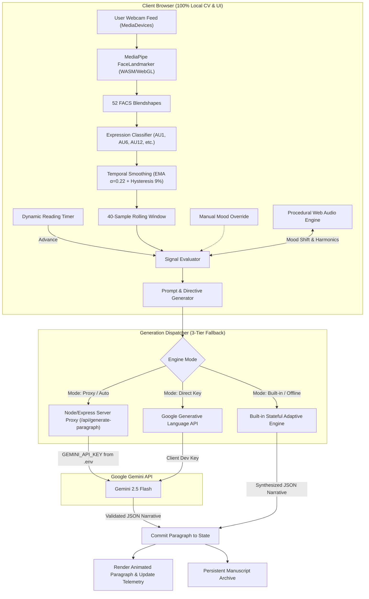

# EMOTIVE — An AI Story That Feels Its Reader

[](https://opensource.org/licenses/MIT)
[](https://github.com/iamnih4l/Emotive/actions)
[](https://nodejs.org/)
[](https://vercel.com/new/clone?repository-url=https%3A%2F%2Fgithub.com%2Fiamnih4l%2FEmotive&env=GEMINI_API_KEY&envDescription=Google%20AI%20Studio%20Gemini%20API%20Key&envLink=https%3A%2F%2Faistudio.google.com%2Fapp%2Fapikey)

> **An interactive storytelling experience powered by Google Gemini that generates narratives one paragraph at a time, dynamically adapting prose, atmosphere, tone, and pacing based on local, browser-side facial expression cues and procedural ambient soundscapes.**

---

## 🌟 Key Features

- **Local Browser Computer Vision (100% Client-Side Privacy)**:
  - Powered by `@mediapipe/tasks-vision` (`FaceLandmarker` with 52 ARKit/FACS facial blendshapes) running via WebAssembly and WebGL.
  - Translates facial action units into 6 emotional cues: `HAPPY`, `SAD`, `SURPRISED`, `FEAR`, `ANGRY`, and `NEUTRAL`.
  - **Zero video frames or biometric templates ever leave your browser.** Only high-level aggregated mood signals shape the next paragraph.
  - Built-in **Exponential Moving Average (EMA)** temporal smoothing, **Hysteresis (±9%)**, and an **Adaptation Cooldown** prevent erratic plot oscillations.

- **Generative Ambient Soundscape Engine**:
  - 100% self-contained procedural **Web Audio API** synthesizer with 3 presets (*Eventide Harbor*, *Midnight Archive*, *Cosmic Orbit*).
  - Features a 4-voice detuned harmonic pad and bandpass-filtered environmental noise (rain, coastal wind, vinyl warmth).
  - Smoothly crossfades harmonic chords and filter cutoffs in real time as the narrative mood shifts.
  - Interactive audio visualizer canvas in the telemetry sidebar.

- **Interactive Emotional Arc Trajectory**:
  - Visualizes the reader's Kurt Vonnegut-style narrative emotional curvature across paragraphs.
  - Smooth bezier spline dynamically reflecting emotional tension, valence, and cathartic peaks.

- **Tri-Tier Narrative Execution**:
  1. **Server Proxy**: Production-ready Express `/api/generate-paragraph` endpoint with rate limiting.
  2. **Direct Client Key**: Optional in-app Google AI Studio key configuration for client-side development.
  3. **Built-in Offline Engine**: Works out-of-the-box without an API key, branching dynamically based on user premise and emotion signals.

- **Persistent Manuscript Archive & Share Cards**:
  - Auto-saves finished stories to `localStorage`.
  - Slide-over archive drawer to review past manuscripts and their emotional evolution maps.
  - Multi-format export: Download as formatted `.TXT`, rich Markdown (`.MD`), or 1-click **Share Story Card** for social media.

---

## 🏗️ System Architecture



---

## 🚀 Quick Start

### 1. Clone & Install

```bash
git clone https://github.com/iamnih4l/Emotive.git
cd Emotive
npm install
```

### 2. Configure Environment

```bash
cp .env.example .env
```

Add your Google AI Studio Gemini API Key in `.env`:
```env
GEMINI_API_KEY=your_gemini_api_key_here
GEMINI_MODEL=gemini-2.5-flash
PORT=3000
```

*(Note: If you run without an API key, EMOTIVE's built-in offline adaptive engine will seamlessly power the story generation!)*

### 3. Launch Development Server

```bash
npm run dev
```

Open `http://localhost:3000` in your browser.

---

## 📂 Project Structure

```
emotive-app/
├── api/
│   └── generate-paragraph.js   # Serverless edge function (Vercel/Netlify)
├── public/
│   ├── css/
│   │   └── style.css           # Literary dark theme, keyframes, and utilities
│   ├── js/
│   │   ├── app.js              # Primary application orchestrator
│   │   ├── audio.js            # Procedural Web Audio ambient soundscape engine
│   │   ├── storage.js          # Persistent manuscript archive & export (TXT/MD)
│   │   ├── storyEngine.js      # Gemini prompt synthesis & offline narrative engine
│   │   └── vision.js           # MediaPipe FaceLandmarker & FACS expression classifier
│   └── index.html              # Responsive single-page interface
├── .env.example                # Sample environment configuration
├── .gitignore                  # Git ignore rules (node_modules, .env, etc.)
├── package.json                # Project dependencies and scripts
├── server.js                   # Node.js/Express backend server
└── README.md                   # Documentation
```

---

## 🔒 Security & Privacy

- **Zero Biometrics Stored**: MediaPipe analysis runs entirely in client-side WebAssembly RAM and discards frames immediately.
- **Safe API Architecture**: Production API keys remain secured on the server proxy.
- **Hardware Teardown**: Stopping the camera explicitly invokes `track.stop()` on all hardware device streams.

---

## 📄 License

MIT License. Crafted with care for adaptive storytelling and ambient computing.
